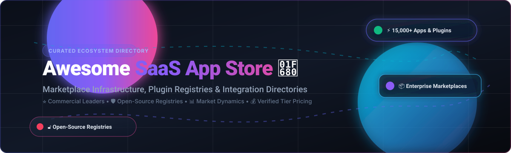

  

# Awesome SaaS App Store 🚀

  
  
  
  
  
  

> 🌟 **A curated directory of SaaS App Stores, Cloud Marketplaces, Plugin Registries, and Extensible Developer Ecosystems.**  
> *Discover leading commercial ecosystems, self-hosted marketplace engines, and developer tools to turn SaaS platforms into extensible multi-sided marketplaces.*

**Last updated: November 2026**

---

## 📑 Table of Contents
- [📈 Sector Overview & Market Dynamics](#-sector-overview--market-dynamics)
- [🏢 SaaS / Hosted Platforms](#-saashosted-platforms)
- [💻 Open-Source GitHub Projects](#-open-source-github-projects)
- [🤝 How to Contribute](#-how-to-contribute)
- [⭐ Star History](#-star-history)
- [☕ Support](#-support)
- [⚠️ Disclaimer](#️-disclaimer)

---

## 📈 Sector Overview & Market Dynamics

The global **Cloud Marketplace & SaaS App Store sector** is estimated at **$18.5 Billion in 2026** and projected to exceed **$85 Billion by 2030**, expanding at a rapid CAGR of ~36% as enterprise buyers increasingly route committed cloud budgets through digital marketplaces. 

The sector exhibits **high concentration (winner-take-most dynamics)** at the foundational cloud infrastructure and enterprise workflow layer—dominated by hyper-scalers (AWS Marketplace, Microsoft AppSource) and ecosystem titans (Salesforce AgentExchange, Shopify App Store, Atlassian Marketplace) which command massive distribution moats and pre-committed spend. Simultaneously, **moderate fragmentation** persists across developer tooling, open-source plugin registries, and vertical B2B commerce ecosystems where self-hosted and niche extensible platforms flourish.

---

## 🏢 SaaS/Hosted Platforms

The following table benchmarks category-leading SaaS app stores and cloud marketplace platforms, sorted by parent company scale (Market Cap / Valuation descending):

| Platform | Company Valuation / Revenue | Starting Tier Pricing | Free Tier / Trial Limit | Key Focus & Ecosystem Highlights |
| :--- | :--- | :--- | :--- | :--- |
| **[Microsoft AppSource](https://appsource.microsoft.com/)** | $3.15 Trillion | $0 listing fee; 3% standard transaction fee on transactable SaaS apps | Free perpetual account on Partner Center; offers 30-day free trial on paid app listings | Enterprise marketplace spanning Microsoft 365, Teams, Dynamics 365, and Power Platform agents. |
| **[Google Workspace Marketplace](https://workspace.google.com/marketplace)** | $2.15 Trillion | $0 listing fee; $5 one-time developer registration fee; 0% cut on direct merchant charges | Free perpetual listing tier; supports free-for-life add-ons and configurable 14-day or 30-day trials | Workspace add-in ecosystem integrating Gmail, Drive, Docs, Sheets, Meet, and Calendar. |
| **[AWS Marketplace](https://aws.amazon.com/marketplace)** | $2.05 Trillion | $0 listing fee; 1.5% to 3% transaction fee on private contracts & commercial software | Free AWS seller registration; paid software offers 15-day or 30-day free trials (pay-only for AWS infrastructure) | Leading enterprise data and cloud software marketplace with 3,500+ commercial offerings drawn against AWS committed spend. |
| **[Salesforce AppExchange (AgentExchange)](https://appexchange.salesforce.com/)** | $310 Billion | $0 for free apps; 15% rev share (ISVforce) or 25% (OEM); $255 one-time security review fee per app | Free perpetual tier for non-monetized/free app listings; 30-day test-drive / free trial for ISV apps | Pioneer cloud marketplace (20+ years); unified into AgentExchange uniting AI agents, Slack apps, and enterprise CRM solutions. |
| **[ServiceNow Store](https://store.servicenow.com/)** | $195 Billion | $5,000/year Technology Partner Program membership; 15% revenue share on transactable store sales | Partner Sandbox environment with 30-day developer instance; enterprise apps offer 30-day free trials | Enterprise app store certified for the Now Platform, ITSM workflows, HR Service Delivery, and SecOps. |
| **[Shopify App Store](https://apps.shopify.com/)** | $145 Billion | 0% rev share on first $1M/year (15% thereafter); $99 one-time Partner registration fee | Free perpetual listing for 100% free apps; paid apps configure 7-day, 14-day, or 30-day trial periods | Largest ecommerce app marketplace with 13,000+ listings empowering merchant storefronts and operational automations. |
| **[Atlassian Marketplace](https://marketplace.atlassian.com/)** | $58 Billion | 10% rev share on Cloud apps (25% on Data Center apps); $0 listing creation fee | Free perpetual tier for all apps on cloud instances up to 10 users; 30-day free trials on paid plans | Comprehensive team collaboration marketplace for Jira, Confluence, Bitbucket, and Trello with 7,000+ listings. |
| **[HubSpot App Marketplace](https://www.hubspot.com/apps)** | $32 Billion | $0 listing fee (0% commission on off-platform billing); $0 developer program enrollment fee | Free perpetual listing tier for certified community integrations; 14-day free trials configured by partners | CRM and marketing automation ecosystem hosting 1,500+ integrations without mandatory in-app checkout coupling. |
| **[Zendesk Apps](https://www.zendesk.com/apps/)** | $10.2 Billion (PE) | $0 listing fee for free apps; $1,500/year for monetized apps on Zendesk Marketplace | Free perpetual listing for free apps; paid customer support tools offer 14-day or 30-day trial configurations | Support ticketing, omnichannel contact center, and customer experience extensions directory. |
| **[Slack App Directory](https://slack.com/apps)** | Part of Salesforce ($310B) | $0 developer submission fee; 15% rev share if monetized via AgentExchange checkout | Free perpetual tier for unlimited free apps; up to 10 custom apps per free Slack workspace; 30-day partner trials | Workspace collaboration and bot hub, now natively connected with Salesforce Agentforce ecosystems. |

---

## 💻 Open-Source GitHub Projects

Explore open-source marketplace engines, plugin registries, extensible application stores, and self-hosted app catalogs.

*Sorted by GitHub Stars_Count (descending):*

| Project | GitHub_Stars | Focus & Architecture |
| :--- | :--- | :--- |
| **[Strapi](https://github.com/strapi/strapi)** |  | Open-source headless CMS with an official built-in **In-App Marketplace** allowing administrators to discover and install community plugins, providers, and custom integrations directly from the admin panel. |
| **[Nextcloud Server](https://github.com/nextcloud/server)** |  | Self-hosted productivity platform featuring the **Nextcloud App Store** (`apps.nextcloud.com`), complete with automated digital signature verification, one-click in-app installation, and release channels. |
| **[Medusa](https://github.com/medusajs/medusa)** |  | Headless digital commerce engine (Node.js/TypeScript). Extensible via its official plugin registry and modular multi-vendor marketplace architecture with granular entity separation and seller payouts. |
| **[Directus](https://github.com/directus/directus)** |  | Real-time backend and data platform providing an official **Directus Marketplace** directly inside the management console for installing extensions, custom API endpoints, displays, and layout modules. |
| **[Mattermost](https://github.com/mattermost/mattermost)** |  | Open-source enterprise collaboration suite featuring a native **Mattermost App & Plugin Marketplace** with signed plugin validation, enterprise bot management, and webhook directories. |
| **[Saleor](https://github.com/saleor/saleor)** |  | High-performance GraphQL-first headless commerce ecosystem featuring a dedicated open-source App Store framework with bidirectional webhooks, asynchronous workers, and customizable dashboards. |
| **[Node-RED](https://github.com/node-red/node-red)** |  | Low-code event-driven integration platform featuring an integrated **Flow & Node Library (Palette Manager)** allowing one-click searching and installing from 4,000+ community modules. |
| **[AltStore](https://github.com/altstoreio/AltStore)** |  | Pioneering open-source alternative application marketplace for iOS and iPadOS, providing decentralized source registries and third-party developer app distribution. |
| **[Frappe Framework](https://github.com/frappe/frappe)** |  | Full-stack Python/JS web framework powering ERPNext; features **Frappe Cloud Marketplace** for publishing, distributing, and deploying vertical SaaS extensions and customized applications. |
| **[Vendure](https://github.com/vendure-ecommerce/vendure)** |  | Headless GraphQL commerce framework built with TypeScript and NestJS, with first-class support for multi-vendor digital marketplaces, custom plugin registries, and third-party vendor onboarding. |
| **[Open VSX](https://github.com/eclipse/openvsx)** |  | Vendor-neutral, open-source alternative to Microsoft Visual Studio Marketplace hosted by the Eclipse Foundation. Offers full-stack Spring Boot registry, React gallery UI, and `ovsx` CLI publishing tools. |
| **[Mercur](https://github.com/mercurjs/mercur)** |  | Multi-vendor marketplace engine built on top of Medusa. Features automated vendor onboarding, split commission handling, admin dashboard, independent seller portals, and Stripe Connect payouts. |
| **[zapstore](https://github.com/zapstore/zapstore)** |  | Permissionless and decentralized application store and publishing client leveraging decentralized protocols for software distribution and sovereign identity verification. |
| **[Einstore](https://github.com/einstore/einstore)** |  | Self-hosted enterprise application directory and mobile distribution platform designed for continuous internal team deployments and secure enterprise APK/IPA artifact sharing. |
| **[Tabularium](https://codeberg.org/Tabularium/Tabularium)** | *(Codeberg)* | Purpose-built self-hosted plugin registry supporting multi-provider Git authentication (GitHub, GitLab, Gitea, Forgejo), signed Ed25519 releases, automated provenance verification, and dynamic category taxonomies. |

---

## 🤝 How to Contribute

Contributions are welcome and appreciated! Follow these steps to submit a platform or repository:

1. 🍴 Fork this repository.
2. 📝 Edit `README.md` following the tabular format and guidelines:
   - For **SaaS Marketplaces**: provide verified starting pricing, explicit free-tier/trial limits, company valuation/revenue, and key ecosystem characteristics.
   - For **Open-Source Repos**: ensure accurate GitHub Stars_Badges linking directly to `/stargazers`, along with a concise architectural summary.
3. 🚀 Submit a pull request with a clear description of your additions.

---

## 🌟 Star History

---

## ☕ Support

Thank you for exploring and using this curated resource! If you found this repository helpful, consider supporting its maintenance and growth:

- ⭐ **Star this repository** to help others discover it.
- 🍴 **Fork and contribute** new platforms, plugin registries, and tools.
- 📢 **Share it** with fellow engineers, builders, and ecosystem architects.
- ☕ **Buy me a coffee / Sponsor**: If you'd like to support ongoing open-source curation and development, you can sponsor via the [GitHub Sponsors Dashboard](https://github.com/sponsors/ishandutta2007).

---

## ⚠️ Disclaimer

- This curated list is maintained by the community for informational and architectural evaluation purposes.
- SaaS app stores managing third-party applications must comply with strict platform security reviews, SOC2/ISO requirements, and privacy regulations (GDPR, CCPA).
- Open-source registries offer great independence at the catalog layer, but commercial platforms hold major distribution moats through existing enterprise billing consolidation and committed cloud spend.
